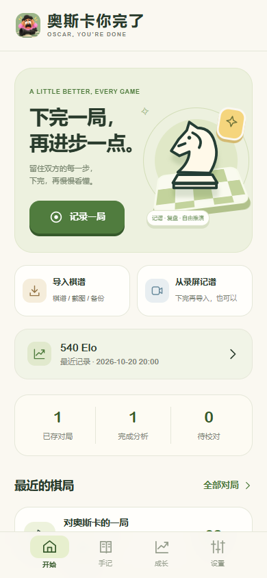
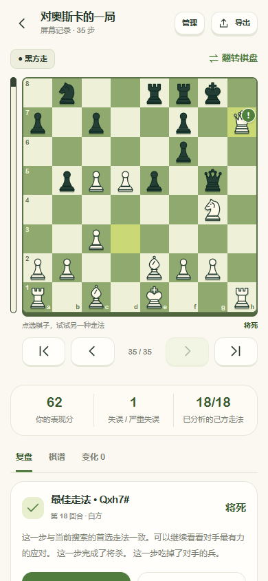
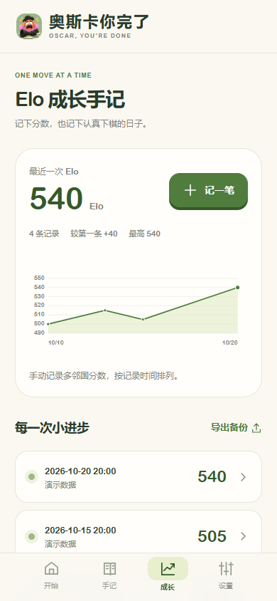
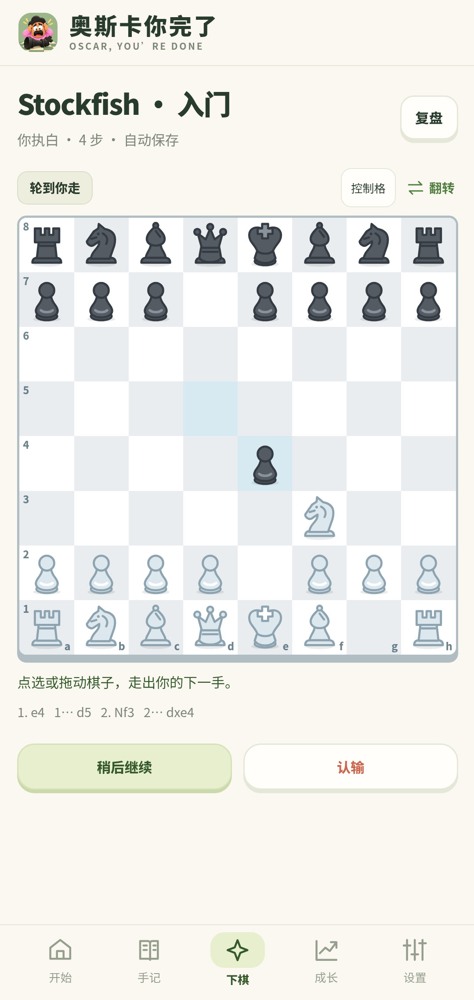
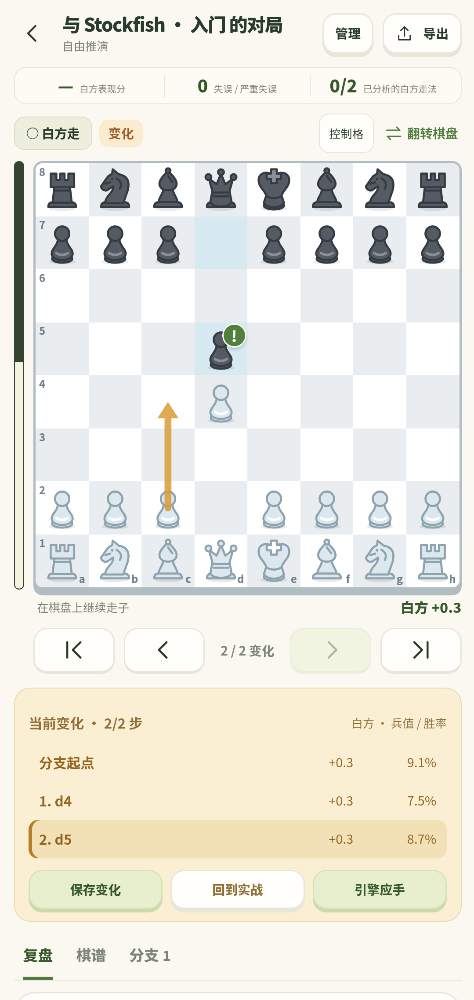
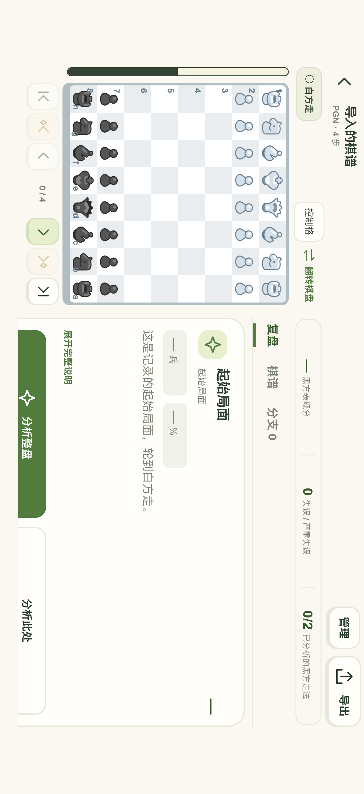
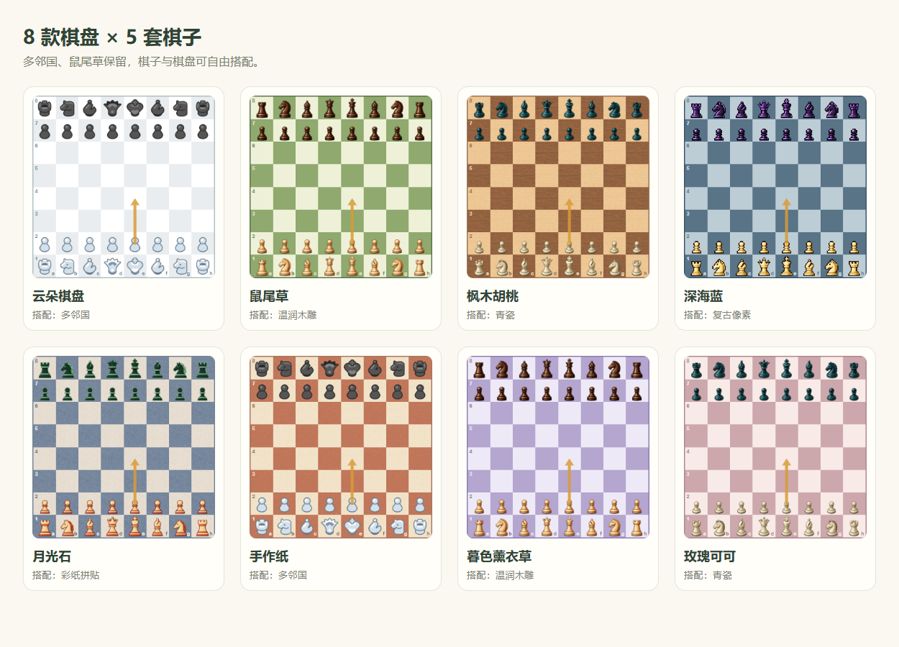
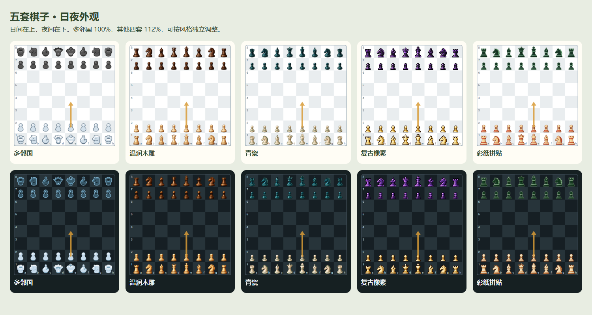

<div align="center">
  
  <h1>奥斯卡你完了</h1>
  <p>给多邻国国际象棋，补上一个复盘搭子。</p>
  <p>
    
    
    
    
  </p>
  <p><a href="https://github.com/Nephelium/oscar-youre-done/releases/tag/v1.3.7"><b>下载 Android 安装包</b></a> · <a href="https://github.com/Nephelium/oscar-youre-done/releases/download/v1.3.7/Oscar-iOS-1.3.7-build2-unsigned.ipa"><b>下载 iPhone IPA（需自行签名）</b></a> · <a href="#开始使用">开始使用</a> · <a href="#从源码构建">从源码构建</a></p>
</div>

---

下完一局，还想知道刚才那步为什么不行？

把双方的走法留下来，交给本地 Stockfish。看局面变化、找更好的选择，再回到棋盘试自己的想法。

**最新版本：v1.3.7**（2026-10-23） · [更新说明](docs/oscar-release-1.3.7.md)

| 平台 | 下载 | 运行环境 |
| --- | --- | --- |
| Android | [下载 APK](https://github.com/Nephelium/oscar-youre-done/releases/download/v1.3.7/oscar-youre-done-1.3.7.apk) | Android 8.0+，ARM64 / x86_64，沿用测试签名 |
| iPhone / iPad | [下载 IPA](https://github.com/Nephelium/oscar-youre-done/releases/download/v1.3.7/Oscar-iOS-1.3.7-build2-unsigned.ipa) | iOS 17.0+，arm64；使用电脑与自己的 Apple 账号签名安装 |

这轮加入 **iOS 基础版**，提供真机 IPA（构建 2，需自行签名），可以导入截图与棋谱、调用本地 Stockfish 复盘、推演分支、与 AI 下棋。Android 新增 GitHub 自动更新提醒，并修复补录撤回、备份关联和分析保存等问题。

| 能力 | Android | iOS（模拟器已验证） |
| --- | :---: | :---: |
| PGN / FEN、截图识别、本地手记 | ✓ | ✓ |
| Stockfish 复盘、自动分析、分支与 AI 对战 | ✓ | ✓ |
| 收藏、Elo、棋子棋盘主题、横屏与日夜模式 | ✓ | ✓ |
| 屏幕实时记谱、录屏导入 | ✓ | 待接入 |
| GitHub 新版提醒 | ✓ | 暂无 |

<p align="center">
  
  
  
</p>

<p align="center"><sub>复盘图来自模拟器真实对局。成长页分数为演示数据。</sub></p>

## 能做什么

| 功能 | 用法 |
| --- | --- |
| 自动记谱 | 下棋前手动开启系统屏幕采集，记录双方走法，结束后保存棋谱 |
| 练习题手记 | 从题目当前局面开始，确认先走方后只记录后续走法 |
| 截图与录屏 | 选择棋盘截图识别局面，或输入录屏起点，确认起始局面后记录不能悔棋的对局 |
| 本地 Stockfish | 整盘 / 单局面分析、三条推荐变化、着法评价、将杀距离；整盘计算期间可自由浏览 |
| 看得见的评价 | 棋子右上角与棋谱同步显示书本、★、!、✓、?!、?、??，曲线切换兵值 / 胜率，拖动游标连续回看 |
| 棋盘外观 | 五套日夜位图棋子、八款棋盘自由搭配，默认多邻国；每套独立调整大小，日夜跟随系统或手动切换 |
| 边走边复盘 | 变化每步自动分析，自适应渐进加深，默认深度与时间双重限制；可关闭或主动开启持续分析 |
| 分支比较 | 新路线满 3 步自动保存，也可手动保存；连续延伸合并，选择多条分支同图对比兵值 / 胜率，退回分出点恢复实战 |
| 关键节点 | 棋盘下方直接前往上 / 下一转折；起点、终点与关键节点跳转均在 1.2 秒内播放 |
| 人机对战 | 六档棋力、五种时制，可选执白 / 执黑，默认禁止悔棋，可在设置开启，局后直接复盘 |
| 开箱演示 | 18 回合完整对局，内置 Stockfish 19 深度 20、三候选与胜和负概率，逐步回看即见角标 |
| 手记与收藏 | 完整对局 / 小练习分开，左滑收藏或删除，删除前确认，自建收藏夹 |
| Elo 成长曲线 | 手动填写当前分数，支持补记日期、备注、修改和删除 |
| 导入与备份 | PGN / FEN / JSON，完整备份包含分析、分支、收藏夹与 Elo 历史 |

识别、记谱和分析均在本地完成。Android 的网络权限仅用于检查本仓库的新版发布信息，设置中可关闭；不上传棋谱、截图、录屏或 Elo。图片使用系统选择器，不申请全相册读取权限。

<p align="center"> </p>
<p align="center"><sub>1.3.0 模拟器实际运行：下棋与分支复盘。</sub></p>

## 开始使用

### Android

1. 从 [v1.3.7 Release](https://github.com/Nephelium/oscar-youre-done/releases/tag/v1.3.7) 下载 APK 并安装。最低 Android 8.0，支持 ARM64 与 x86_64。
2. 点 **记录一局**，选棋盘底部颜色，授权本次屏幕采集。整个屏幕与仅共享多邻国都支持，随后点 **回到多邻国**。
3. 自动定位棋盘后，确认走子会短暂提示，设置中可关闭。返回 App 可查看最近采集画面、调整识别范围。下完从通知栏、悬浮按钮或 App 内结束记录。
4. 打开手记，点 **分析整盘**。点推荐变化或直接在棋盘走子，开始自己的推演。

### iPhone / iPad

1. 下载上方 **未签名 IPA**，在 Windows / Mac 安装 [Sideloadly](https://sideloadly.io/) 或 AltStore Classic。
2. 连接 iPhone，用自己的免费 Apple 账号签名安装。根据系统提示开启开发者模式并信任自己的签名。
3. 免费签名 7 天后到期，需定期刷新；满足连接条件时可使用工具的自动刷新功能。

**无需购买开发者会员，但需要电脑完成签名。** 详细步骤见 [iPhone 安装说明](docs/oscar-ios-installation.md)。直接在手机上点开 IPA 不会安装。

首页点 **导入一局**，粘贴 PGN / FEN，或选择 **导入棋盘截图**。截图识别后先核对棋子位置、先走方与特殊权利，再保存到小练习。也可以打开演示，或从 **下棋** 页面与 Stockfish 对战。

真机包已通过 iPhoneOS / arm64 编译和包体检查，功能已在模拟器验证，**尚未进行 iPhone 真机安装与运行测试**。iOS 录屏导入与跨应用实时采集尚未接入。模拟器仍可[从源码构建](ios/README.md#在-mac-上启动)，本次 Release 附件改为真机 IPA。

<p align="center"></p>
<p align="center"><sub>iOS 模拟器实际触摸测试截图。<a href="ios/README.md">构建与测试</a> · <a href="docs/oscar-ios-simulator-verification.md">验收记录</a></sub></p>

### 自动检查更新 · Android

启动后在后台检查 GitHub 正式 Release，成功结果缓存 24 小时。发现新版时，首页与设置提供下载入口。也可在 **设置 → 版本更新** 手动检查或关闭自动检查。下载与安装由用户确认，升级保留已有手记。

### 记一道练习题

已内置多邻国日夜棋子识别，无需先录完整对局。可选 **从当前练习局面开始**，也可在 **导入棋谱 → 导入棋盘截图** 中选图。确认棋子位置和先走方后，保存到小练习手记。

截图看不出易位与吃过路兵权利，需要时在高级 FEN 中填写。识别疑点会保留对应棋盘画面，供补走校对。Android 删除手记时会移除该手记与内部裁剪，外部原图保留。

### 处理待校对提示

点 **查看 → 对应疑点 → 从这里补走**，补齐后保存，提示与终局胜负会一起更新。其他尚未处理的疑点继续保留。棋谱已完整时，可选 **现有棋谱已完整 → 确认完整**，不必再补走一步。

升级后旧手记无需重新导入。已有棋谱能确认终局时，会恢复胜负并处理对应的结尾未确认提示。修订前的走法、疑点和分支保留在完整备份中。

### 看懂分数

- 局面分数跟随棋盘底部颜色，`+1.0` 表示该方评价领先约一兵。翻转后，分数、候选分数、曲线、评价条和表现统计一起切换。`M` 表示将杀距离。纵轴可切换 ±2 / ±5 / ±10 兵，坐标文字保持正常比例。
- 走法符号来自相邻局面的引擎评价。书本表示已收录的理论走法，★ 表示引擎首选，! 表示好棋，✓ 表示稳健，?! / ? / ?? 表示递增的评价损失。[预置分析、开局来源与评级细则](review/demo-analysis.md)。
- 复盘表现分按当前视角一方的平均评价损失计算。Elo 由用户手动记录，保存在独立历史中。
- 首页演示的分析和推演只在本次运行保留，不计入手记。旧版保存过的演示可从首页“旧版演示与变化”找回，也可主动保留为正式手记。

### 边走边分析，留住不同想法

在复盘棋盘上试走，会开始本地分析。新路线满 3 步后自动保存，手动保存不限步数，沿已保存路线继续走会更新同一分支。琥珀色表示当前变化，绿色表示实战。回看后改走其他走法，从分歧处重新计算保存步数。退到分支起点，界面恢复实战；在 **分支** 页随时打开各次尝试。

在 **局面起伏 → 对比分支** 中勾选保存的路线，用不同颜色叠加查看。被长路线完整包含的短分支会合并，保留真正不同的走法。仅导入一张截图时，也能沿分支拖动进度、逐步查看局面和评价。

**设置 → 变化自动分析** 默认开启。自适应先计算 0.2 秒，停留时以 0.7 / 1.8 / 4 秒继续加深，单局面累计约 7 秒计算量，默认最高 20 层。也可选择固定速度和 12～28 层上限。只有主动开启 **持续分析，不限深度** 才持续搜索当前局面，结果会刷新；走子、退出复盘或切到后台会停止旧搜索。

走法说明列出实际吃子、将军、升变、合法攻击和引擎推荐线。兵值 / 获胜概率变化用两个数字呈现，概率变化单位为百分点，点 **展开完整说明** 查看具体含义。关键节点按钮放在前后步按钮旁，支持向前与向后浏览。跨步跳转统一在 1.2 秒内播放，长棋谱加速，随时可用下一次导航或拖动中断。关闭走子动画后直接到达。

### 收藏与下棋

在首页或手记页左滑一篇手记，可收藏或删除，也可点 **⋯**。删除需要再次确认。收藏可放进自己创建的收藏夹，导出完整备份后会一并保留。

底部 **下棋** 页提供六档本地 Stockfish 对战。等级直接使用引擎 Skill Level，不虚构对应 Elo。每步自动保存，稍后回来可以接着下；结束后进入同一套复盘页面。复盘会恢复引擎全力分析。可选 3、5、10 分钟、15 分钟加 10 秒以及不限时，默认 10 分钟。离开对战或后台暂停时钟，返回时可继续。设置中的允许悔棋默认关闭，开启后撤回自己上一手及其 AI 应手，恢复该回合时钟。

### 连贯地看一盘棋

在设置中选择喜欢的棋子与棋盘，走子动画也可以随时关闭。复盘评价区预留固定空间，说明较长时可在文字区域滚动。局面曲线下方的滑块支持连续拖动，也可以直接在图上拖动或点选。

胜率使用 [Stockfish 的 WDL 模型](https://github.com/official-stockfish/WDL_model)，显示当前视角一方的获胜概率，和棋单独列出。它基于引擎自对弈，未使用个人 Elo 预测实战。旧分析若缺少概率，点补充分析即可。

<p align="center"></p>

棋子与材质通过内置 imagegen 生成，[素材与提示词](review/assets/pieces/README.md)可查。多邻国与鼠尾草棋盘保留，新增枫木胡桃、月光石、手作纸、薰衣草与玫瑰可可。横屏采用左侧棋盘、右侧独立滚动的分析区，旋转时保留当前页面和计算。

<p align="center"></p>

日夜模式默认跟随系统，设置中可手动选择。界面采用统一配色，换棋盘不会改变主界面颜色。棋子大小按风格独立记忆，范围 85%～125%，多邻国默认 100%，其他四套默认 112%。

### 记录时能看见进度 · Android

每次确认走子或撤回会短暂显示中文提示。设置中的 **走子识别提示** 默认开启。授权悬浮窗后可连续显示，未授权时使用 Android 系统文字提示，系统可能[限制后台提示频率](https://developer.android.com/reference/android/widget/Toast)。棋盘自动定位后仍可整体移动选框或拖动四角微调。

录屏可拖动时间轴或直接输入数字选择起点，先核对识别出的局面及先走方，再开始导入。选框支持整体移动与四角微调。选择视频后立即显示读取状态，确认后显示识别百分比、视频进度和已记录步数；完成后点开手记。

**录屏导入用于不能悔棋的对局；练习题请导入棋盘截图。** 点击棋子产生的选中效果会与实际走子区分。漏采后，能唯一推断的合法短路径会自动补全；较大缺口保留校对入口，并从之后能确认的局面继续记录。

## 性能验证

### v1.3.5 · 录屏与采集优化

这轮优化减少棋盘区域复制和重复绘制，复用颜色统计内存，并加快图片颜色转换。保留原采样位置与识别阈值，以同一段录屏逐步核对棋谱。

2026-10-21，在同一台 Android API 36.1 x86_64 模拟器（1080 × 2400、host GPU）中，对约 **275 秒、720 × 1280 的 HEVC 录屏**进行完整导入。耗时包含预览、起始局面识别及保存，旧版也在本轮环境重新测量。

| 版本 | 第一次 | 第二次 | 平均耗时 | 棋谱核对 | 待校对 |
| --- | ---: | ---: | ---: | --- | ---: |
| v1.3.4 同环境基线 | 60.04 秒 | 59.68 秒 | **59.86 秒** | 67 / 67 步一致 | 0 |
| v1.3.5 | 50.66 秒 | 51.66 秒 | **51.16 秒** | 67 / 67 步一致 | 0 |

平均耗时缩短 **14.5%**，最快正确结果为 **50.66 秒**。两版都提取 1,319 帧，其中 1,094 帧分类、225 帧复用结果，本轮加速没有减少采样。表中的一步指一方走一次。

实时测试通过系统屏幕采集记录视频回放：原速完整还原 **67 / 67 步，0 待校对**。2 倍与 3 倍回放未完整通过，播放端也发生明显掉帧，目前只能确认此环境下原速通过，尚不能给出稳定倍速上限。以上为模拟器结果，手机耗时与实时表现需要实机测量。

每秒仅取一帧、只解码关键帧的实验均出现漏记，未用于正式路径。1 / 2 / 4 帧采集档位尚未开放。私人测试录屏、截图和完整棋谱不随仓库分发。

[1.3.5 完整验证报告](docs/oscar-verification-1.3.5.md)记录了采用与未采用的实验、测试环境和结果。

## 验证记录

v1.3.7 的 [代码审查](docs/oscar-audit-1.3.7.md)覆盖补录游标、备份关系、正在导入的记录保护、分析缓存、异常可选字段与更新检查。[iOS 验收](docs/oscar-ios-simulator-verification.md)覆盖真实 Stockfish、WebKit 存储、截图确认、系统相册触摸、日夜与横竖屏。模拟器结果与手机实际表现分别记录。

v1.3.4 复用画面转换内存，并让下一帧解码与当前帧识别交错进行。同一段约 275 秒录屏，旧版本轮两次为 89.8 / 88.6 秒，新版三次为 68.8 / 74.1 / 70.0 秒，每次 67 步完全一致。实时采集合并裁剪与缩放、复用位图。性能数据与设备边界见 [详细验证记录](docs/oscar-verification-1.3.4.md)，此前真实多邻国对局的证据保留在对应版本报告中。

v1.2.1 在 Android 16 模拟器的真实多邻国 6.102.3 中完成执黑全屏记录，70 步以黑方将杀结束，零未解决校对项。中途切回本 App 后继续记录，71 个局面的整盘复盘通过。最终包另验中途局面起录、短提示、关闭与设置持久化。10 项 Android 回归覆盖初始模板污染、黑方朝向、晚起录两步、练习多步撤回、带黑边录屏和升变。物理手机兼容性仍需实际复测。[详细验证记录](docs/oscar-verification-1.2.1.md)。

v1.2.0 新增概率解析、动画、易位与升变、连续快点、鼠标 / 触摸 / 键盘拖动、36 个局面评价区高度、外观选择和持久化检查。安卓模拟器另验本地引擎 WDL 与触摸滑块连续性。

v1.1.1 聚焦坐标文字、双向评价、终局提示与演示体验。新增六种宽度下的等比例文字检查、视角转换与数据不变检查、黑方先走的回合编号，以及预置分析与模拟器演示存储隔离回归。

v1.1.0 已在 Android 16 x86_64 模拟器、实际安装的多邻国 6.102.3 中完成：

- 一盘新的完整实时对局，35 步，以 `Qh7#` 结束，棋谱与胜负正确，零待校对项。
- 对这盘棋的全部 36 个局面调用 Stockfish，验证独立分支、重开保留与 PGN 导出。
- 从残缺局面开始记录升后练习，9 步包含 `d7d8q`，升变选择框恢复后疑点自动消除。
- 系统截图选择器、识别、局面确认、本地分析、推演、删除和外部原图保留。
- 4 项 Android 实际画面流水线回归，以及规则、手记、Elo、手机布局与交互测试。

当前为 debug 签名的 Android 测试版。物理手机上的系统采集和不同棋盘主题仍需实机验证，反馈请附 Android 版本与可复现步骤。

## 从源码构建

### Android

需要 Android SDK（API 36）、兼容 Gradle 9.2.1 / Android Gradle Plugin 9.0 的 JDK。先在 Android Studio 打开 `android/` 完成 SDK 定位，或在当前终端设置 `ANDROID_HOME` 为本机 SDK 路径。Gradle Wrapper 已包含在仓库中。

```powershell
Set-Location android
.\gradlew.bat :recorder:testDebugUnitTest :recorder:lintDebug :recorder:assembleDebug
```

APK：`android/recorder/build/outputs/apk/debug/recorder-debug.apk`。

界面为原生 HTML / CSS / JavaScript，共享源码在 `review/`。可以直接打开 `review/index.html` 查看、导入和推演，跨应用采集由 Android 提供，本地引擎由 Android / iOS 的原生层提供。

```powershell
npm install
npm test
npm run test:ui
```

UI 测试使用 Playwright，Windows 默认运行已安装的 Edge。设备测试脚本会操作连接的测试模拟器。

Android 真实画面回归所需样本单独附在 [1.1.0 Release](https://github.com/Nephelium/oscar-youre-done/releases/tag/v1.1.0) 的 `duolingo-vision-fixtures.zip` 中，解压到 `android/recorder/build/reports/`。本轮新增的录屏样本可用 FFmpeg 生成，再执行：

```powershell
python tests/review-capture-regression-video.py
node tests/review-capture-regression-ui.js
.\android\gradlew.bat -p android :recorder:connectedDebugAndroidTest
```

日夜及点选棋子验收使用本地自备画面：`official-day.jpg`、`official-night.jpg`、`selected-queen.png`、`unselected-queen.png`，放到测试设备的 `/sdcard/Android/data/com.jingjing.chesssprout/files/`。这些私人画面不随源码或安装包分发。对应测试为 `AppearanceVisionTest` 与 `CapturePerformanceTest` 的选中棋子用例。

### iOS

在已完成 Xcode 初始化的 Mac 上克隆本仓库，然后执行：

```bash
bash ios/scripts/run_simulator.sh --build
```

脚本使用 Python 标准库生成 Xcode 工程，同步共享界面，以源码编译 Stockfish 19，并校验官方 NNUE 的 SHA-256。无需 CocoaPods、XcodeGen 或开发者签名。已构建后运行时省略 `--build`。具体要求与测试命令见 [iOS 开发说明](ios/README.md)。

### 目录

```text
review/                  共享界面、棋谱、自动分析策略、收藏与 Elo
src/controlMap.js        原开局训练项目共享的控制格计算
android/recorder/        屏幕采集、图片 / 视频识别、存储、引擎与测试
ios/                    Swift / WKWebView、原生 Stockfish、截图识别与模拟器构建
vendor/                 规则库、棋子、引擎、NNUE、许可和来源哈希
tests/                  规则、界面与 Android 链路测试
docs/                   截图、验证说明与发布记录
```

## 开源与致谢

本项目软件源码采用 [GPL-3.0](LICENSE)。第三方组件沿用其各自许可，见 [NOTICE](NOTICE) 与 `vendor/`。

- [Stockfish](https://github.com/official-stockfish/Stockfish)：Android ARM64 使用官方 Stockfish 19，Android x86_64 使用 F-Droid DroidFish 1.90 中的 Stockfish 16.1；iOS 从源码编译 Stockfish 19。Release 附对应源码材料，App 设置中也提供许可与源码入口。
- [chess.js](https://github.com/jhlywa/chess.js)：BSD-2-Clause。
- [chesslib](https://github.com/bhlangonijr/chesslib)：Apache-2.0。

这是独立项目，与 Duolingo 无隶属关系。Duolingo 与奥斯卡角色的权利归原权利人；图标根据角色参考图生成，角色图像不纳入本项目软件 GPL 授权。公开测试截图仅作为兼容性验证材料。
